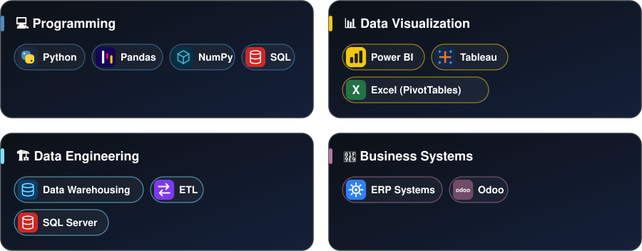
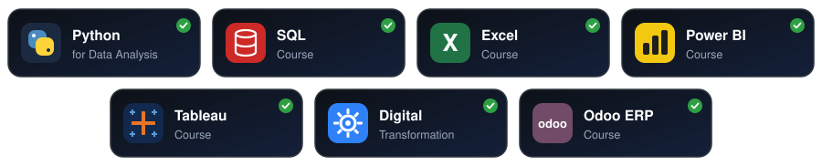

  
  
  

<b>🟢 Open to internships &amp; entry-level Data Analyst roles</b>

 

<h2 align="center">👨‍💻 About Me &nbsp;|&nbsp; نبذة عني</h2>

<b>Management Information Systems (MIS)</b> graduate from <b>Obour Institute</b>. 
I build dashboards and data pipelines that help teams make faster, better decisions.

<table align="center">
  <tr>
    <td align="center">🔭 <b>Building</b> Dashboards, Data Warehouses, ETL</td>
    <td align="center">🌱 <b>Learning</b> Advanced SQL, Python for analytics</td>
    <td align="center">🎯 <b>Goal</b> My first Data Analyst role</td>
    <td align="center">💬 <b>Ask me about</b> Power BI, SQL Server, Excel, Odoo</td>
  </tr>
</table>

 

<h2 align="center">🛠️ Skills &nbsp;|&nbsp; المهارات التقنية</h2>

 

<h2 align="center">📂 Featured Projects &nbsp;|&nbsp; المشاريع</h2>

 

<h2 align="center">🎓 Courses &nbsp;|&nbsp; الدورات التدريبية</h2>

Completed at <b>Obour Institute</b>

 

<h2 align="center">🌍 Languages &nbsp;|&nbsp; اللغات</h2>

  
  
  

 

<h3>📫 Let's work together</h3>

